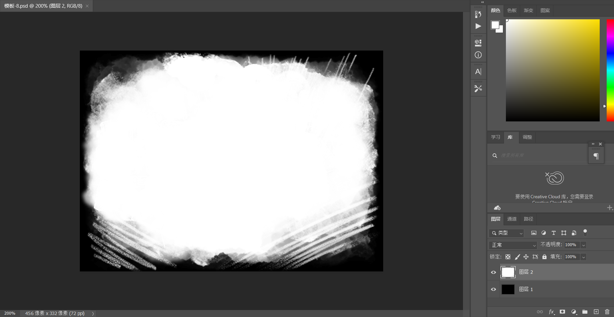
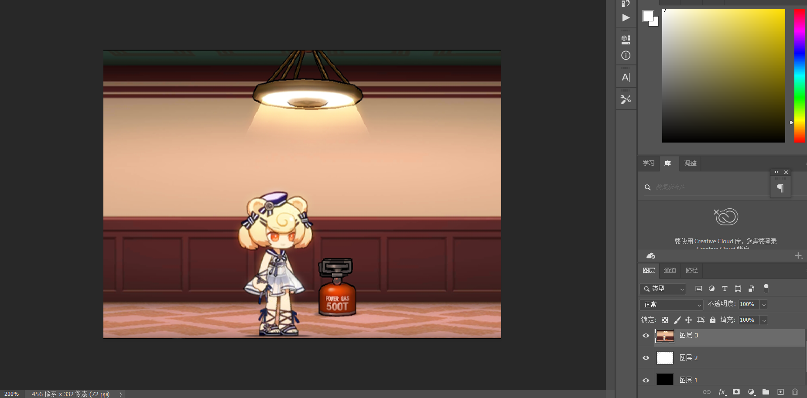
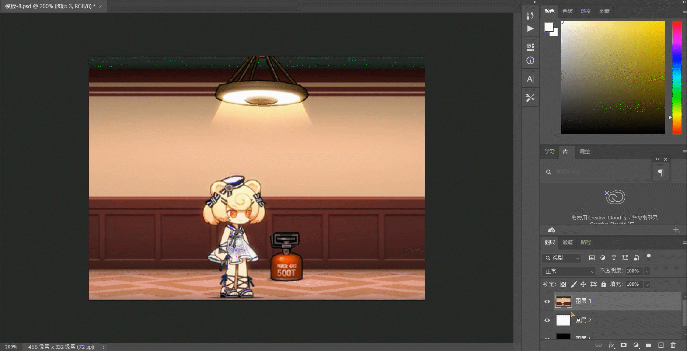
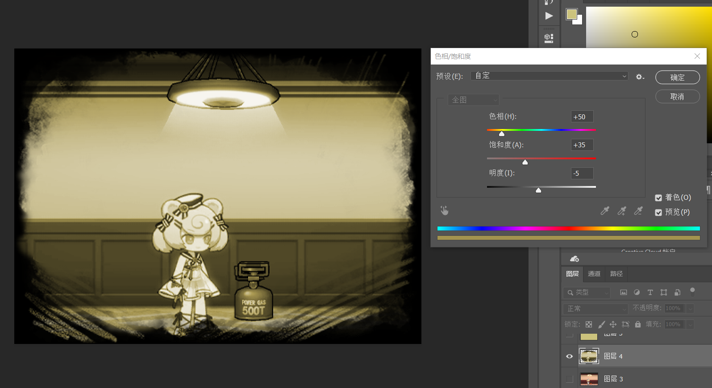

# 历史时刻模板使用说明

> 来源：用户提供的社区模板包内《如何使用.docx》（45,621,258 B，SHA-256 bc3cf9aa5f316ae5077199d7ede38f36101b5de98c7b0028b27d36eb778ff601）。
> 2026-10-29 按原文件正文与内嵌截图转换为 Markdown + 压缩截图；原 .docx 不随源码分发（归档在本机 workspace/）。
> 适用：moments/*.psd（456×332 历史时刻模板）的裁切、着色与黄色正片叠底用法。

首先用PS打开一个模板（如图）

将你要制作的图片导入

(下一页)

开始操作

1.选中图层3

2.Ctrl+鼠标左键图层2

3.Ctrl+J

4.关闭多余图层

调整颜色使其匹配历史图表

两种方法

最简单的方法

选中已经剪切好的图像

Ctrl+U并勾选着色（这里截图是大致演示方法，请根据你自己图片颜色来处理）

创建黄色图层并正片叠底，这样的图片会更好调整颜色饱和度等

这里就不多介绍了

如果可以，麻烦在创意工坊给我来点赞，谢谢各位
